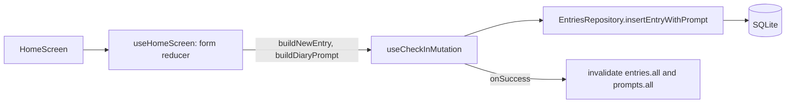
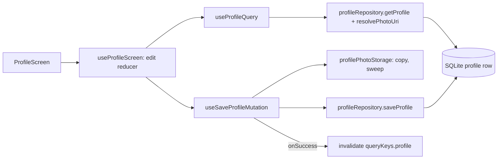

# Architecture

A short map of the code as it is today (foundation, the Home check-in and the offline part of Profile; Dashboard, Diary, Settings and Chat are placeholders). Rules live in [../CLAUDE.md](../CLAUDE.md); decisions in [SPEC.md](SPEC.md) and [adr/](adr/README.md).

## Folder map

| Path | Purpose |
|---|---|
| `src/app/` | Expo Router routes (D38). Thin: re-export a screen plus route options. `_layout.tsx` (root Stack), `(drawer)/_layout.tsx`, `(drawer)/(tabs)/_layout.tsx` and screens `index`, `dashboard`, `diary`, `profile`, `settings`; `chat.tsx` |
| `src/ui/screens/` | One folder per screen (`HomeScreen`, `DashboardScreen`, `DiaryScreen`, `ProfileScreen`, `SettingsScreen`, `ChatScreen`) |
| `src/ui/components/` | Shared components: `AppProviders`, `ThemedPaperProvider`, `AppReadyGate`, `AppErrorBoundary`, `AppDrawerContent`, `ScreenHeader` (title, optional trailing `actions`), `EmojiPicker` (one radio row per scale), `NoteFields` (three note inputs), `LeaveGuardProvider` (shared leave-guard registry around the Drawer), `ProfileAvatar` (photo or placeholder) |
| `src/ui/widgets/` | Small reusable widgets: `HapticTabButton`, `EmojiTile` (one radio tile), `TabBarIcon` (`TabBarIcon`, `useTabBarIcon`, `TabSelectedContext`: renders only the visible tab icon layer) |
| `src/hooks/` | Cross-screen hooks: `useAppBootstrap`, `useQueryFocusManager`, `useRepositories` (binds repositories to the SQLite connection; the seam screen tests mock), `useCheckInMutation`, `useProfileQuery`, `useSaveProfileMutation`, `useLeaveGuard` (leave-guard registry and hooks), `useFontScaleRelayoutPass`, `useScrollIntoView` (scrolls a focused field into view above the keyboard with a 16pt margin; used by Home via `NoteFields`) |
| `src/services/db/` | SQLite: `migrations.ts`, `schema.v1.ts`, repositories: `entriesRepository` and `promptsRepository` are implemented (factories over the structural `SqlDatabase` type, [ADR 008](adr/008-repositories-over-structural-db-type.md)); `profileRepository` (`createProfileRepository`: `getProfile`, `saveProfile` upsert, `resetProfile`) is also on `SqlDatabase` |
| `src/services/storage/` | `mmkv.ts` (single instance), `settingsStorage.ts` (typed MMKV access), `secureKeyStore.ts` (API key in SecureStore), `profilePhotoStorage.ts` (profile photo files and the picker cache sweep), `firstRun.ts`, `backupExclusion.ts` (JS wrapper for the `NoBackup` module, verification only) |
| `src/services/query/` | `queryClient.ts`, `queryKeys.ts` |
| `src/state/` | Redux: `store.ts`, `settingsSlice.ts`, `persistSettings.ts` (MMKV middleware), `hooks.ts` |
| `src/themes/` | `palettes.ts`, `paperTheme.ts`, `useAppTheme.ts`, `contrast.ts` |
| `src/constants/` | `database.ts`, `limits.ts`, `scales.ts`, `storageKeys.ts`, `textScaling.ts` (`UNCAPPED_FONT_SCALE`, relayout delay), `dataLocations.ts` (where data lives, incl. `PROFILE_PHOTO_DIR`; no-backup rule) |
| `src/utils/` | `dates.ts`, `tabAccessibility.ts`, `checkIn.ts` (form to new entry), `diaryPrompt.ts` (prompt text), `postCheckIn.ts` (what follows a save), `profile.ts` (bio clamp and counter text) |
| `src/types/` | `dates.ts`, `db.ts` (rows and `SqlDatabase`), `settings.ts` |
| `src/tests/` | `__tests__/`, `__mocks__/`, `helpers/`, `setup.ts` |
| `modules/no-backup/` | Local Expo module, iOS only, autolinked from `./modules`: an AppDelegate subscriber marks `Documents/` and `Library/Application Support/` excluded from backup at every launch (D49, [ADR 006](adr/006-no-backup.md)) |

`plugins/` holds local Expo config plugins (see [Native config](#native-config-cng-and-plugins)).

Not built yet (planned in the spec): `src/services/anthropic/`, `src/services/notifications/`, a `chat` Redux slice, `src/constants/env.ts`, `.env.example`, Axios (with the Daily Inspiration quote, the next PR) and FlashList. Environment variables arrive with Axios; see [Environment variables](#environment-variables).

Each component, screen or widget has its own PascalCase folder: `Name.tsx` (view), `Name.props.ts` (prop types and styles) and `useName.ts` (logic, when there is any).

## Navigation

Root Stack → Drawer → JS Tabs; Chat is a root Stack screen. See [ADR 001](adr/001-navigation-drawer-js-tabs.md).

**Tab icons.** The JS tab bar renders each tab's `tabBarIcon` twice (`focused: true` and `false`), stacked and switched by opacity, so both icons would sit in the accessibility tree. `HapticTabButton` reads the tab's real selected state from `aria-selected` and shares it through `TabSelectedContext`; `TabBarIcon` (via `useTabBarIcon`) renders only the layer whose `focused` matches it, so only the active icon is exposed to screen readers. Outside a tab button the icon always renders.

## Native config (CNG) and plugins

`ios/` and `android/` are generated and git-ignored; native config goes through `app.json` and config plugins ([../CLAUDE.md](../CLAUDE.md), "Stack and builds"). Local plugins live in `plugins/` and are listed in `app.json` `plugins`.

- `plugins/withAndroidFontScaleConfigChange.js` adds `fontScale` to `MainActivity`'s `android:configChanges`. Changing the system **Font size** then no longer recreates the activity, so in-memory state such as the Home draft survives. React Native re-lays out with the new scale in place.
- Known limitation: changing **Display size** (density) still recreates the activity and loses the draft. `density` is deliberately not handled because density-dependent pixel values are converted once when views mount. Persisting the draft would be the alternative.
- Native config changes need a rebuild: `npx expo prebuild --clean -p android` then `npx expo run:android`, or a new EAS development build.

## Environment variables

None exist yet. They arrive with the Axios feature (policy in [ADR 009](adr/009-env-files-policy.md)): only `.env.example` is committed, `.env` is git-ignored, and values are public `EXPO_PUBLIC_*` only, read once in `src/constants/env.ts`. EAS builds use EAS environment variables.

## Home check-in (feature)

There is no per-feature doc convention yet, so features are described here. For the user's view, see the [CHANGELOG](../CHANGELOG.md).

**What it does.** Home is the mood check-in (SPEC §1.3, §3.1-3.4). Three rows of emoji tiles: mood (displayed 1 → 5), stress and anxiety (displayed 5 → 1; stored values are never reversed, [ADR 003](adr/003-scale-model.md)). Nothing is pre-selected. When the stored stress or anxiety value is 4 or more, three optional note inputs appear for that row (50 characters each, with an `n/50` counter). Dropping the value below 4 hides the inputs and clears their text. Notes are saved trimmed, and blank ones as `null`.

**Files.** `src/ui/screens/HomeScreen/` (`HomeScreen.tsx`, `HomeScreen.props.ts`, `useHomeScreen.ts`), `src/ui/components/EmojiPicker/`, `src/ui/components/NoteFields/`, `src/ui/widgets/EmojiTile/`. The route `src/app/(drawer)/(tabs)/index.tsx` re-exports the screen.

**Data flow.**

- Form state is local (`useReducer` in `useHomeScreen`); nothing goes to Redux.
- `buildNewEntry(form, now)` takes `timestamp` (UTC ISO) and `tz_offset_min` from the same `now` (D20, [ADR 004](adr/004-time-model.md)). The entry's day is derived from those two values, never from the device zone later.
- `insertEntryWithPrompt` inserts the entry and its diary prompt in one `withTransactionAsync` transaction, then deletes diary prompts older than the 90-day cutoff (D3, `purgeCutoffIso`). Entries are never purged.
- Cache invalidation is in the mutation's hook-level `onSuccess` (`queryKeys.entries.all`, `queryKeys.prompts.all`), not in per-call callbacks.
- A ref (`inFlight`) blocks a second tap before the first save re-renders the button as disabled. A local save can finish before the second tap lands, so a Submit on the untouched, just-reset form within `RESUBMIT_GUARD_MS` (1 s) of a successful save is ignored too.
- No schema change (`SCHEMA_VERSION` stays 1) and no new dependencies.

**States.**
- Submit with a row unset: "Please choose one." under each unset row, plus a screen-reader announcement ("Please select your mood and anxiety level before submitting."). Nothing is saved. The screen scrolls to the first row with an error, and any "Saved!" Snackbar is hidden.
- Saving: the button shows a spinner and is disabled.
- Success: the form resets and a "Saved! Your mood has been recorded." Snackbar shows. iOS also announces it with `AccessibilityInfo.announceForAccessibilityWithOptions(message, { queue: true })`, so VoiceOver does not cut it off; Paper's Snackbar live region is Android-only.
- Failure: "Couldn't save your check-in. Try again." under the button and announced; the form keeps its values. The error is not logged or shown, since it could echo notes.
- `decidePostCheckIn` already encodes the AI outcomes (first-time dialog, "Talk about your mood?"), but `hasApiKey` is always false until Settings can store a key, so only "Saved!" can occur today.

**Accessibility.** Each row is a `radiogroup` labelled with its question; tiles are `radio` with `checked` state and word-only labels (no numbers). Tiles are in display order in the view tree so screen-reader order matches the visual order. Selected state is a fill, a thicker border and a check badge (not colour-only); the label keeps its weight so the longest word stays legible. The end labels under each row are hidden from screen readers because tile labels already carry the direction. Note inputs are labelled "Stressor 1 of 3" / "Trigger 1 of 3", and the counters read "n of 50 characters". Tile labels are one line and shrink to fit (`TILE_LABEL_MIN_FONT_SCALE`, max growth `TILE_LABEL_MAX_FONT_SCALE`); the longest label is "Stressfree" (11pt) and the top stress label is "Crushed".

**Not built yet (deferred).**
- AI dialogs and handoff to Chat (slice 2; needs the Redux `chat` slice).
- Cancelling today's reminders after a check-in (Notifications milestone; hooks into `useCheckInMutation`).
- Purging old prompts at app start or foreground (Diary milestone). Today the purge happens only when an entry is saved.
- Per-theme background image (not decided).

**Verified on a device.** Device QA on 2026-10-09 (iPhone 17 Pro, iOS 26.0 simulator; Pixel 9 Pro XL, API 35 emulator):
- Android keyboard handling (`KeyboardAvoidingView` with `behavior="padding"` on both platforms, since Android is edge-to-edge, plus scroll-into-view via `useScrollIntoView`) behaves correctly on both platforms.
- Android Font size change (1.3 and 2.0, then back to 1.0) keeps the draft (tiles, typed note and counter) and the text re-measures with no crash, after the `fontScale` `configChanges` plugin and a clean prebuild.
- Android Display size (density) change loses the draft, with no crash (known limitation).
- Exactly one tab icon per tab in the accessibility tree on both platforms, also after a Chat round-trip and on hidden tabs.
- The "Crushed" rename and tile labels fit at default and largest text sizes.
- Double-tapping Submit saves one entry.

Not verified: VoiceOver/TalkBack announcements were not audibly checked; iPhone SE and other small devices are untested; JS console warnings were not reviewed in the last QA run. Observed once: a rare iOS stale-layout glitch after changing Dynamic Type at runtime in the dev client; a JS reload fixes it, and it is probably dev-client/simulator level.

**Known limitations and open risks.**
- Android Display size (density) changes recreate the activity and lose the draft (see [Native config](#native-config-cng-and-plugins)).
- Small screens and the very largest text sizes on them are untested.
- Late bootstrap result: when the API-key Settings feature is built, it must follow the rule in [../CLAUDE.md](../CLAUDE.md) "Startup" for a bootstrap result that arrives after the timeout.

**Tests.** All under `src/tests/__tests__/`:
- `ui/screens/HomeScreen/` (`HomeScreen.test.tsx`, `useHomeScreen.test.ts`)
- `hooks/` (`useCheckInMutation.test.tsx`, `useRepositories.test.tsx`, `useScrollIntoView.test.ts`)
- `ui/components/EmojiPicker/`, `ui/components/NoteFields/`, `ui/widgets/EmojiTile/`
- `utils/` (`checkIn.test.ts`, `diaryPrompt.test.ts`, `postCheckIn.test.ts`)
- `services/` (`entriesRepository.test.ts`, `promptsRepository.test.ts`)

## Profile (feature)

**What it does.** Profile (SPEC §1.7) shows a photo and a bio. It is a hidden tab reached from the Drawer (`src/app/(drawer)/(tabs)/profile.tsx`). This is Slice A (offline); the Daily Inspiration card (Axios, ZenQuotes) is Slice B and **not built yet**. Decisions: [ADR 011](adr/011-profile-photo-storage.md), [ADR 012](adr/012-leave-guard-registry.md), [ADR 013](adr/013-live-text-size-relayout.md).

**Modes.** View mode shows the avatar (`expo-image`, 120 circle, or a placeholder) and the bio, or "No bio yet. Use Edit profile to add one." Edit mode starts with the header pencil ("Edit profile"); X ("Cancel editing") and the check mark ("Save profile") replace it. The bio is multiline, capped at `BIO_LIMIT` (1000) with an "n / 1000" counter and "Character limit reached."; it is focused when edit mode starts. The photo can be changed only in edit mode, with "Remove photo" next to it. Save, Cancel, the avatar and Remove are disabled while the picker is open. Saving shows a "Profile saved" Snackbar; Edit presses are ignored for `EDIT_AFTER_SAVE_GUARD_MS` (1 s) after a save so a double tap on Save does not reopen edit mode.

**Files.** `src/ui/screens/ProfileScreen/` (`ProfileScreen.tsx`, `.props.ts`, `useProfileScreen.ts`), `src/ui/components/ProfileAvatar/`, `src/ui/components/LeaveGuardProvider/`, `src/hooks/` (`useProfileQuery.ts`, `useSaveProfileMutation.ts`, `useLeaveGuard.ts`), `src/services/db/profileRepository.ts`, `src/services/storage/profilePhotoStorage.ts`, `src/utils/profile.ts`.

**Data flow.**

**State placement.** The edit draft (mode, draft bio, draft photo change) is local to the screen hook (`useReducer`); nothing goes to Redux. The saved profile is TanStack Query data under `queryKeys.profile()` (`staleTime: Infinity`, since only this app writes it); the mutation invalidates it in its hook-level `onSuccess`. A ref blocks a second Save before the button re-renders as disabled.

**Photo lifecycle.**
1. The system photo picker (no permission) returns a cache file; the draft keeps that URI until Save.
2. Save (`saveProfile` in `useSaveProfileMutation.ts`) copies it to `<documents>/profile/<unique name>`, writes `bio` and the **file name only** to `profile.photo_uri`, then deletes every other file in that folder. If the database write fails, the new copy is deleted. If the picked cache file is gone, the user is asked to pick again.
3. `useProfileQuery` resolves the file name to a displayable URI (`resolvePhotoUri`); a missing or unsafe file name shows the placeholder.
4. `sweepPickerCache` deletes all files in `<cache>/ImagePicker/` after save, cancel, discard, leaving, replace or remove (Android also writes a pre-crop source copy), but not while the picker is open. The sweep owns that whole folder app-wide.
5. `resetProfile` and `deleteAllProfilePhotos` exist for the future Delete-all (D30); nothing calls them yet.

**Leave guard.** Leaving Profile mid-edit with unsaved changes (tab press, drawer item, Android back) shows a "Discard changes?" dialog ("Keep editing" / "Discard"); leaving discards the draft. Cancel (X) does not ask. JS Tabs keep screens mounted, so `beforeRemove` never fires; a registry (`LeaveGuardProvider` + `useLeaveGuard`) is asked by the Tabs `tabPress` listener, the drawer items and the hardware back handler ([ADR 012](adr/012-leave-guard-registry.md)).

**Live text-size changes (app-wide).** `usePaperTheme` applies `withTextRelayoutPass(theme, useFontScaleRelayoutPass())`, which makes every Paper text re-measure after a system text-size change without remounting; tab labels use `textRelayoutStyle`. On Android, a font-scale change while the app stays in the foreground reaches JS only on the next resume. `ScreenHeader` is a plain-view header that copies Paper's MD3 layout (it is not `Appbar.Header`: on iOS Paper's `Surface` stops the bar growing, so large titles clipped). It has `minHeight: 64`, no `height`, and an uncapped wrapping title; the buttons are still Paper `Appbar.Action` / `BackAction` ([ADR 014](adr/014-screen-header-not-appbar.md)). Paper's implicit 1.5 caps are removed with `UNCAPPED_FONT_SCALE` (ESLint-enforced); see [ADR 010](adr/010-font-scale-caps.md), [ADR 013](adr/013-live-text-size-relayout.md).

**Bio label.** The Bio input has no Paper floating label (it clipped at the largest text sizes). A visible "Bio" `Text` (`labelLarge`, `onSurfaceVariant`) sits above it, hidden from screen readers, and the input's `accessibilityLabel` is "Bio" (`BIO_LABEL`).

**Known limitations / follow-ups (not fixed).**
- iOS: drawer items clip at the largest text size (fixed item height in `AppDrawerContent`).
- The "Discard changes?" dialog overflows the screen at the largest text size.
- Android: the drawer's Settings item was once missing after a live font-scale change (seen once, not reproduced).
- Android: a font-scale change while the app stays in the foreground stays stale until the app resumes (ADR 013).

**Permissions and storage.** No permission is requested; the `expo-image-picker` plugin has all usage strings off and Android blocks `CAMERA`, `RECORD_AUDIO`, `READ_EXTERNAL_STORAGE` and `WRITE_EXTERNAL_STORAGE`. The photo folder sits inside the no-backup locations ([ADR 006](adr/006-no-backup.md)). `exif: false` does not strip metadata from the saved file (ADR 011).

**States.** Loading and load error ("Couldn't load your profile."), save error ("Couldn't save your profile. Try again."), picker error ("Couldn't open your photos. Try again."), picked photo gone ("That photo is no longer available. Please pick it again."), "Photo removed". Error details are never logged (they could contain file paths or bio text).

**Native change.** New native modules and plugin config: run `npx expo prebuild --clean` and make a new development build ([CONTRIBUTING](CONTRIBUTING.md)).

**Tests.** Under `src/tests/__tests__/`: `ui/screens/ProfileScreen/ProfileScreen.test.tsx`, `ui/screens/ProfileScreen/useProfileScreen.test.ts`, `ui/components/ProfileAvatar/ProfileAvatar.test.tsx`, `hooks/useProfileQuery.test.tsx`, `hooks/useSaveProfileMutation.test.tsx`, `hooks/useLeaveGuard.test.tsx`, `hooks/useFontScaleRelayoutPass.test.ts`, `services/profileRepository.test.ts`, `services/profilePhotoStorage.test.ts`, `utils/profile.test.ts` and `config/eslintTextScaling.test.ts`. Related existing tests were extended (`ui/ScreenHeader.test.tsx`, `ui/AppDrawerContent.test.tsx`, `themes/paperTheme.test.tsx`, `app/navigation.test.tsx`). Mocks: `src/tests/__mocks__/expo-file-system.ts`, `expo-image-picker.ts`; helpers: `src/tests/helpers/fileSystemMock.ts`, `expoRouterFocusMock.ts`. As reported by the developer: 52+ suites, about 1100 tests, Profile files near 100% coverage (not re-run by the docs writer).

## Startup sequence

On iOS, before any JS runs, `NoBackupAppDelegateSubscriber` (`modules/no-backup`) flags the data directories excluded from backup (D49). Then:

1. `src/app/_layout.tsx` calls `SplashScreen.preventAutoHideAsync()` at module scope, so the native splash stays up.
2. The root layout renders `AppProviders` (`src/ui/components/AppProviders/AppProviders.tsx`): GestureHandlerRootView → Redux → QueryClientProvider → PaperProvider (`ThemedPaperProvider`, `src/ui/components/ThemedPaperProvider/`) → `SQLiteProvider` → `AppReadyGate`.
3. The Redux store is created with settings read synchronously from MMKV, so the first frame has the right theme (`hasApiKey` starts `false`).
4. `SQLiteProvider` runs `onInit = migrateDbIfNeeded` (`src/services/db/migrations.ts`): connection setup (`PRAGMA foreign_keys = ON`, WAL), then pending migrations by `user_version`, each in a transaction. It renders nothing until this finishes.
5. `AppReadyGate` runs `useAppBootstrap`: first-install cleanup, then derives `hasApiKey` from SecureStore. A SecureStore failure does not block startup. A timeout (`BOOTSTRAP_TIMEOUT_MS`, 4 s, in `src/constants/limits.ts`) also covers a call that never settles: the app becomes ready with `hasApiKey = false`, and if bootstrap finishes later its real result still updates `hasApiKey`.
6. When bootstrap settles (or times out), `AppReadyGate` renders the app; its first layout calls `SplashScreen.hide()` once.
7. `AppErrorBoundary` (exported as `ErrorBoundary` from the root layout) also hides the splash, so a startup failure such as a throwing migration shows an error instead of a stuck splash.

## State placement

| Kind of state | Where | Example today |
|---|---|---|
| Used by one component | `useState` in the component hook | `useAppBootstrap` readiness |
| Shared inside a screen | Screen hook | Home check-in form (`useReducer`) and snackbar visibility, both in `useHomeScreen`; Profile edit draft in `useProfileScreen` |
| Rarely changing subtree value | React Context | Paper theme, SQLite context (library-provided) |
| Cross-screen, persisted or navigation-surviving | Redux slice | `settings` (persisted to MMKV) |
| Local database data | TanStack Query over SQLite repositories | keys in `queryKeys.ts` (entries, prompts, profile, quote) |
| Non-secret persisted values | MMKV via `settingsStorage.ts` | theme, reminder, flags |
| Secrets | SecureStore via `secureKeyStore.ts` | Anthropic API key |

Details and rationale: [ADR 002](adr/002-state-and-storage-stack.md). Scales: [ADR 003](adr/003-scale-model.md). Dates: [ADR 004](adr/004-time-model.md). Theme: [ADR 005](adr/005-theme-contrast-option-c.md). Backups: [ADR 006](adr/006-no-backup.md). Repositories: [ADR 008](adr/008-repositories-over-structural-db-type.md). Photos: [ADR 011](adr/011-profile-photo-storage.md). Leave guard: [ADR 012](adr/012-leave-guard-registry.md). Text size: [ADR 010](adr/010-font-scale-caps.md), [ADR 013](adr/013-live-text-size-relayout.md). Header: [ADR 014](adr/014-screen-header-not-appbar.md).

## Adding a screen or feature

1. **Route:** add a file under `src/app/` (inside `(drawer)/(tabs)/` for a tab screen) that only re-exports the screen, e.g. `export { HomeScreen as default } from '@/ui/screens/HomeScreen/HomeScreen';`. Hidden tabs also need a `Tabs.Screen` with `options={{ href: null }}` in `(drawer)/(tabs)/_layout.tsx`.
2. **Screen:** create `src/ui/screens/NameScreen/` with `NameScreen.tsx`, `NameScreen.props.ts` (styles through `makeStyles(theme)`; no inline styles) and `useNameScreen.ts` for logic.
3. **Data:** put SQL in a repository under `src/services/db/`, add keys to `src/services/query/queryKeys.ts`, and read through a TanStack Query hook; invalidate the key family after writes. Do not put database data in Redux.
4. **State:** pick the lowest level that works (see the table). Add a Redux slice only for cross-screen or persisted state, and register it in `rootReducer` in `src/state/store.ts`.
5. **Accessibility:** icon buttons get an `accessibilityLabel`, selectable items expose `accessibilityState.selected`, selected state is never colour-only. Add any new colour tokens to the contrast test.
6. **Tests:** add tests in `src/tests/__tests__/`; run `yarn run check`.
7. **Docs:** record new decisions in SPEC and, if significant, an ADR; add a feature doc and in-app help text once the feature is user-facing.
